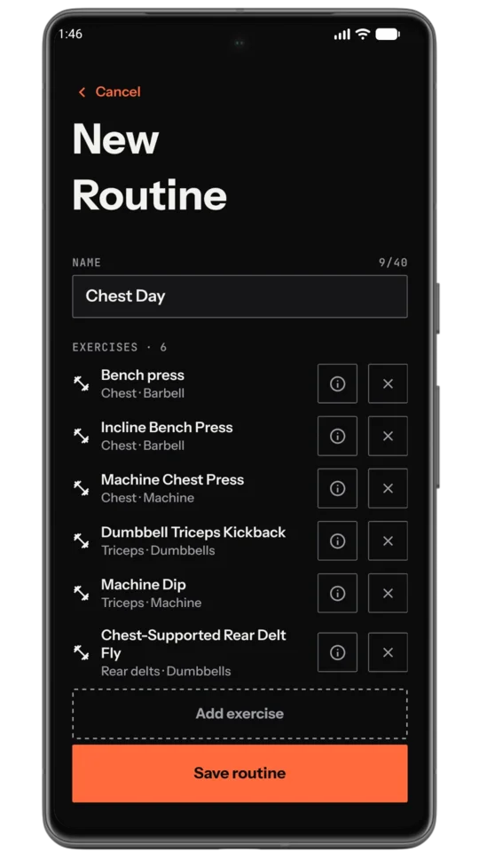
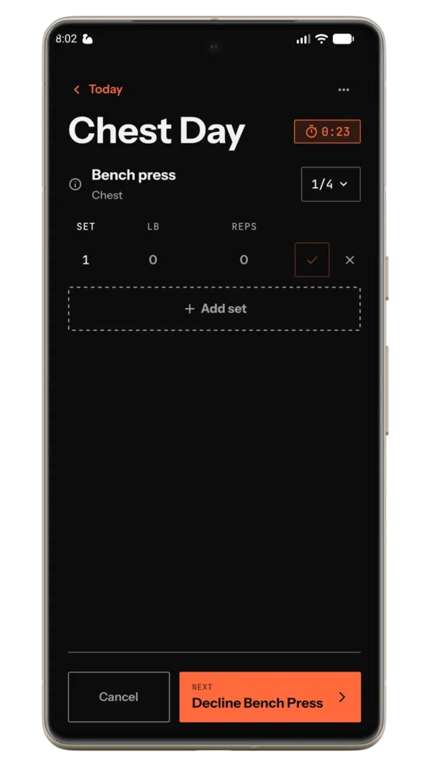
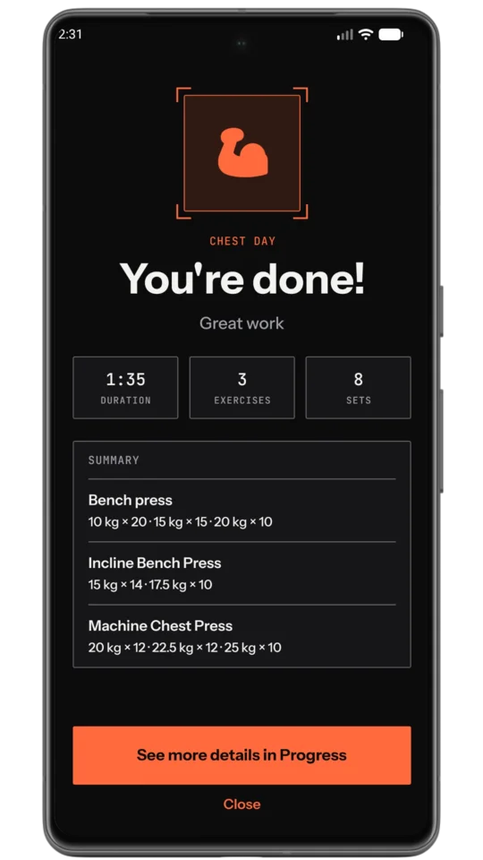
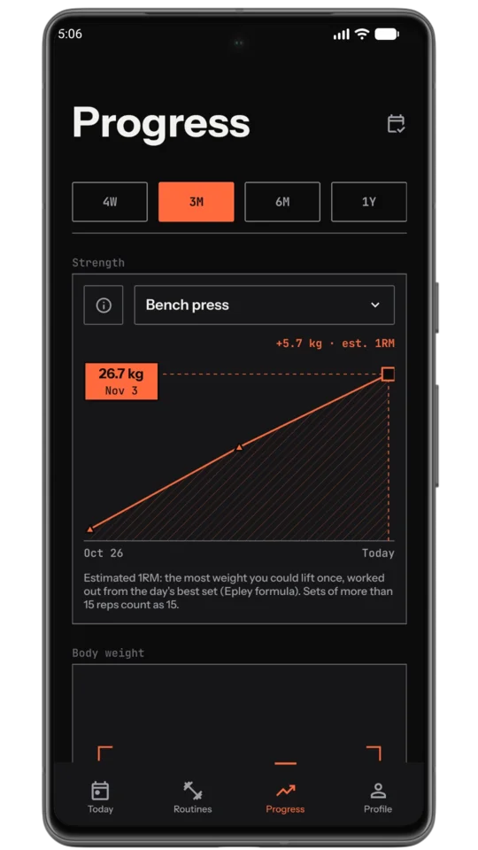
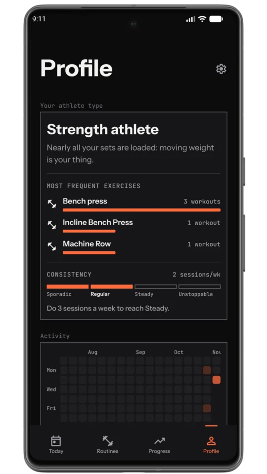
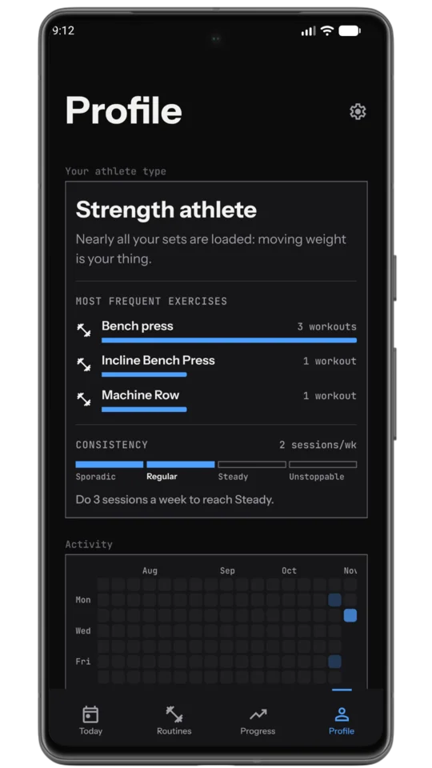
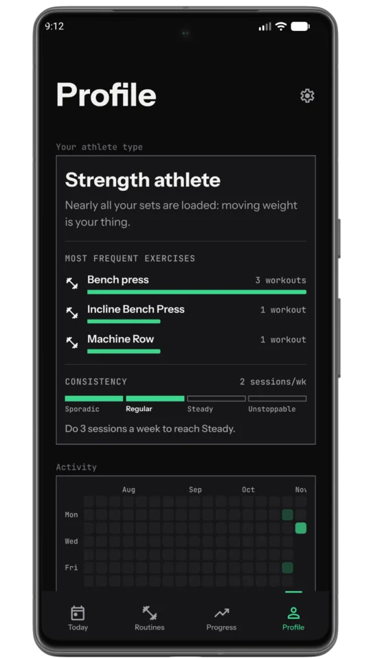
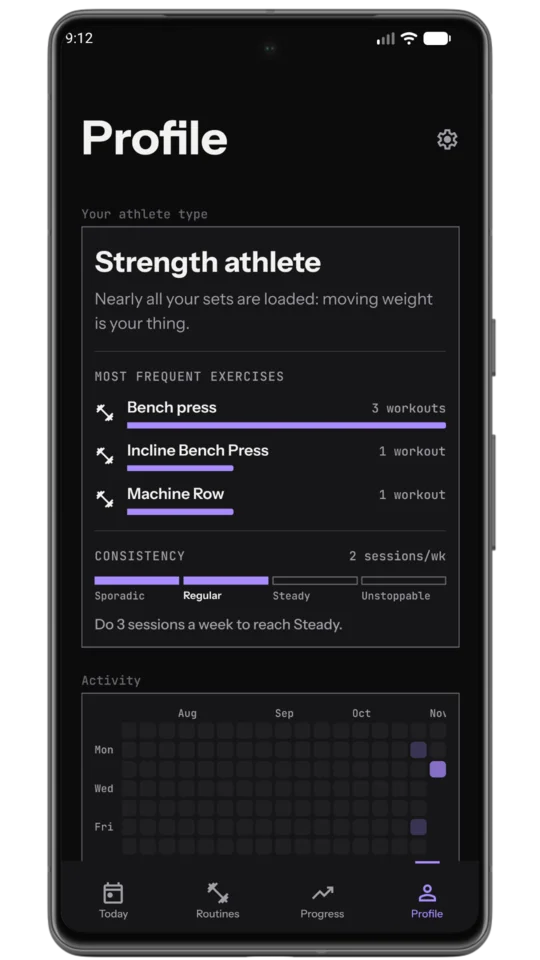
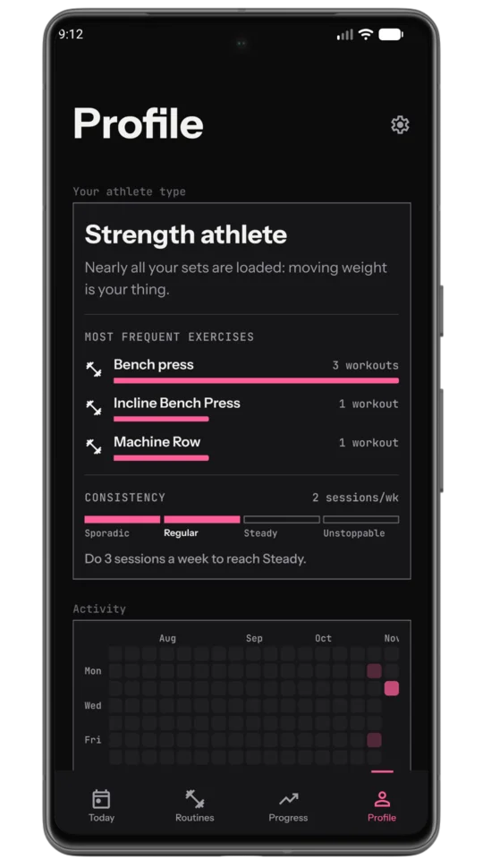
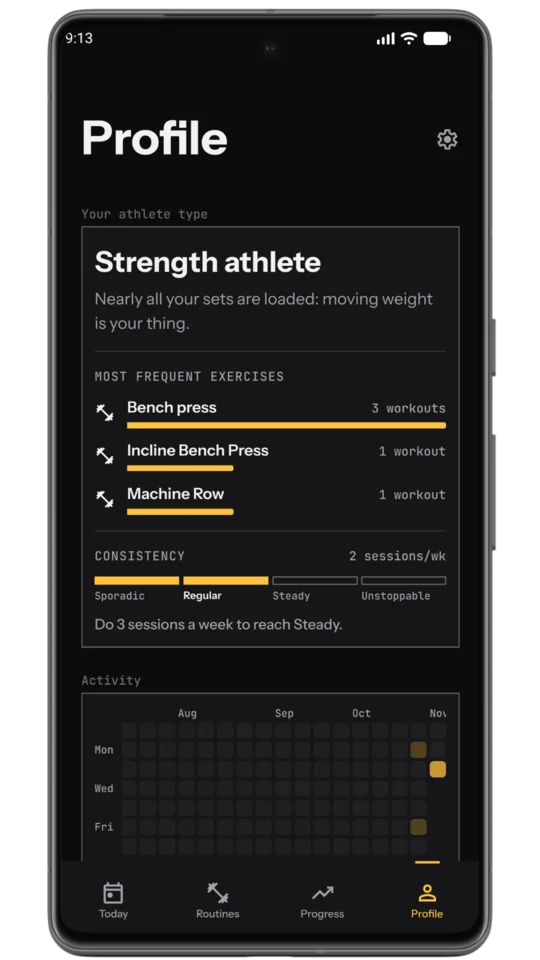

<p align="center">
  
</p>

<h1 align="center">Fort</h1>

<p align="center">
  An offline-first gym routine tracker for Android, built with React Native and Expo.
</p>

<p align="center">
  
  
  
  
  
  
</p>

<p align="center">
  <a href="https://play.google.com/store/apps/details?id=com.marcelesplu.fort"><strong>Get it on Google Play</strong></a>
  ·
  <a href="https://fort.marcel14.dev/"><strong>Website</strong></a>
</p>

<p align="center">
  
  
  
  
</p>

## Table of contents

- [About](#about)
- [Features](#features)
- [Tech stack](#tech-stack)
- [Architecture](#architecture)
- [Design decisions](#design-decisions)
- [Getting started](#getting-started)
- [Testing](#testing)
- [Building and releasing](#building-and-releasing)
- [Privacy](#privacy)
- [Use of AI](#use-of-ai)
- [Roadmap and known limitations](#roadmap-and-known-limitations)
- [Acknowledgements](#acknowledgements)
- [References](#references)
- [License](#license)
- [Author](#author)

## About

Fort is a gym tracker built around reusable routines. I usually train the same exercises split across three days, often twice a week, so instead of building every session from scratch, you create a routine once and run it whenever you train. Fort logs each set, times your rests, shows what you did last time and charts how you progress.

- **Everything stays on your device.** No account, no server, no ads and no analytics.
- **Works offline.** The data lives in a local SQLite database.
- **Six languages:** English, Spanish, Catalan, Basque, French and Portuguese.
- **Your way:** light, dark or system theme, six accent colors, and kg or lb, km or mi.

## Features

### Today

- Your week at a glance, with the days you trained and the ones you missed.
- Every routine ready to start. A workout in progress stays there to be continued, even after closing the app.

### Routines

- Create, edit and delete routines.
- Choose exercises from a catalog of 313, each with its muscles, equipment, description and an illustration. Search them and filter by muscle or by tracking type.
- Add your own exercises when one is missing.

### Workout

- Step through the routine's exercises with the workout timer running, and add extra exercises on the fly without changing the routine.
- See what you did last time next to each set.
- After each set, start a rest timer or go straight on.
- On Android, an ongoing notification shows the routine, the current exercise and a running chronometer.
- Finish to see a summary of what you did. Sets not marked as done are discarded.

Each exercise is tracked according to its type:

| Type            | What you log                                                                   |
| --------------- | ------------------------------------------------------------------------------ |
| Weight and reps | Weight and reps for each set.                                                  |
| Bodyweight      | Reps for each set.                                                             |
| Duration        | A stopwatch that saves a set each time it stops. It can be paused and resumed. |
| Distance        | The same stopwatch, with the distance typed in afterwards.                     |

### History

- Browse past days with their workouts and weigh-ins.
- Correct a finished workout: edit, add or remove sets and exercises, or delete it.
- Log a routine you did on a past day and forgot to record.

### Progress

- A chart per exercise over 4 weeks, 3 months, 6 months or a year: the estimated one-rep max for weighted exercises, the best set for bodyweight ones, the best time for timed ones and the speed for distance ones.
- Body weight, with one weigh-in per day, its chart and the latest entries.
- Body mass index on the WHO bands, using the WHO growth reference from 5 to 19 years old.

### Profile

- Your athlete type (strength, calisthenics, endurance or all-round), worked out from the sets you do, and your most frequent exercises.
- Your consistency level from your weekly sessions, and an activity calendar of the last 31 weeks.

### Settings

- Theme, accent color, language and units.
- Your profile (height, date of birth and gender), used for the body mass index.
- Your custom exercises.
- Notifications, on Android: the workout in progress and a weekly weigh-in reminder.
- Export all your data to a JSON file, and import it on another device.
- The privacy policy and information about the app.

<p align="center">
  
  
  
  
  
  
</p>

## Tech stack

| Technology                                                                                                                                        | Why                                                                                                                                                                                                                                  |
| ------------------------------------------------------------------------------------------------------------------------------------------------- | ------------------------------------------------------------------------------------------------------------------------------------------------------------------------------------------------------------------------------------ |
| [React Native](https://reactnative.dev)                                                                                                           | One codebase for Android and iOS, accepting some limits compared with fully native apps.                                                                                                                                             |
| [Expo](https://expo.dev) (SDK 58), [Expo Router](https://docs.expo.dev/router/introduction/) and [EAS](https://docs.expo.dev/eas/)                | The app is mostly about logging and showing data, so a managed toolchain made sense: file-based routes, development builds and store builds without maintaining the native projects by hand.                                         |
| [TypeScript](https://www.typescriptlang.org) (strict)                                                                                             | Static types catch mistakes when data moves between the database, the domain and the screens, and TypeScript fits naturally in the React Native ecosystem.                                                                           |
| [SQLite](https://docs.expo.dev/versions/latest/sdk/sqlite/) (`expo-sqlite`)                                                                       | The app needs no server or API, so the data lives in a light database on the device, a common choice for mobile apps.                                                                                                                |
| [Drizzle ORM](https://orm.drizzle.team)                                                                                                           | Typed schema and queries close to SQL, a direct Expo SQLite driver, versioned migrations and live queries for the UI. I also considered Prisma, which is great on backends, but Drizzle fits a local database with no server better. |
| `StyleSheet` and design tokens                                                                                                                    | Tailwind would have needed NativeWind and extra setup. Plain styles with shared tokens for colors, spacing and type sizes, all in one file, kept the project simple.                                                                 |
| [react-native-svg](https://github.com/software-mansion/react-native-svg)                                                                          | The progress and body weight charts are drawn in SVG by hand, without a charting library, so they match the rest of the app.                                                                                                         |
| [Reanimated](https://docs.swmansion.com/react-native-reanimated/) and [Gesture Handler](https://docs.swmansion.com/react-native-gesture-handler/) | Layout animations and gestures that run on the UI thread.                                                                                                                                                                            |
| [Expo Modules API](https://docs.expo.dev/modules/overview/) (Kotlin)                                                                              | The Android notifications are two small local native modules instead of a notifications library (see [Design decisions](#platform)).                                                                                                 |
| [expo-localization](https://docs.expo.dev/versions/latest/sdk/localization/)                                                                      | Picks the device language. The texts are typed objects, one file per area and language, with no i18n library.                                                                                                                        |
| [Jest](https://jestjs.io)                                                                                                                         | I wanted to start writing automated tests with this project. The data tests run the real queries on an in-memory SQLite database.                                                                                                    |
| [React Compiler](https://react.dev/learn/react-compiler)                                                                                          | Memoizes components and hooks automatically.                                                                                                                                                                                         |

## Architecture

```
Screens and components          src/app, src/components
        │  feature hooks (reads) and functions (writes)
        ▼
Feature data layer              src/features/<area>/queries.ts
        │  Drizzle queries and live-query hooks
        ▼
Drizzle ORM
        │
        ▼
SQLite on the device            expo-sqlite
```

- **Screens never talk to the database.** They read through the live-query hooks of each feature and write through plain functions such as `completeSet` or `deleteSet`. Since a screen doesn't know where its data comes from, only the data layer will change when an API arrives.
- **Offline-first.** SQLite stays the source of truth for the UI. A future sync layer will write to it, and the screens will keep reading local data.
- **Ready to sync.** Every table uses UUID string ids, which can be created offline on several devices without colliding (two phones would both create `id = 5` with autoincrement), and keeps `created_at` and `updated_at` to tell which version of a row is newer.
- **Domain types are independent of the database rows**, and schema changes go through versioned Drizzle migrations that run on startup.
- **Small preferences** (theme, language, units and profile) live in Expo SQLite's key-value store.

```
src/
├── app/                # Routes (Expo Router): screens and layouts only
├── features/           # One folder per area: catalog data, domain types and data access
│   ├── body/           # Body weight and body mass index
│   ├── data/           # Backup export and import
│   ├── exercises/      # Exercise catalog and custom exercises
│   ├── notifications/  # Workout notification and weigh-in reminder (Android)
│   ├── profile/        # Athlete type and activity calendar
│   ├── progress/       # Progress charts per exercise
│   ├── routines/       # Routines
│   ├── settings/       # Saved preferences (theme, color, language, units, profile)
│   └── workouts/       # Workouts: sets, rests and stopwatches
├── components/         # Reusable UI (generic in ui/, the rest by area)
├── hooks/              # Generic hooks, not tied to a feature
├── i18n/               # Texts per language (es, en, ca, eu, fr, pt)
├── constants/          # Theme tokens, enums and app information
├── utils/              # Pure helpers (dates, text, lists, numbers, durations)
├── db/                 # Local database: client, schema and migrations
└── test/               # Test utilities
modules/                # Local native modules, Android only (notifications)
assets/                 # Icon, splash (SVG sources in images/source/) and exercise images
```

Imports use the `@/` alias for `src/` (for example, `@/features/routines/queries`).

## Design decisions

### Data

- **Weights and distances are always stored in kg and meters.** The unit the user picks is only used to show and type values (`src/utils/units.ts`, `useUnits`). Storing the chosen unit would mix units in the history as soon as it changed. Converting back and forth also rounds (62.5 kg is 137.8 lb, and 137.8 lb is no longer exactly 62.5 kg), so a weight left untouched in a set row keeps the stored kilograms instead of converting the shown pounds back.
- **Days are grouped in JavaScript, not in SQL.** Times are stored as instants. Grouping them by day in SQL would use UTC days, so a workout at 00:30 in Spain would land on the day before. JavaScript uses the phone's time zone, and Today and the history share the same day key. Days travel in routes as local `YYYY-MM-DD` strings (`toDateKey`, `parseDateKey`).
- **Two live queries instead of a join.** `useLiveQuery` only re-runs when the main table of its query changes. The history reads the workouts and the done sets in two queries and joins them in JavaScript (`toWorkoutHistory`): with a single join, marking a set wouldn't refresh the summary.
- **Queries live apart from hooks, so they can be tested.** Queries such as `dailyExerciseRowsQuery` are plain functions, and hooks such as `useDailyExerciseCounts` only connect them to `useLiveQuery`. Hooks only run while a component renders, but plain functions can be tested with Jest against an in-memory database.
- **Catalog exercises are translated, not stored.** Each one has a stable key (`bench_press`), and its name and description come from the translation files, so adding a language never touches the database. Only custom exercises store a name.
- **Backups reference the catalog by key, and importing merges.** A catalog exercise has a different id on each install, so a backup points to it by key, and to custom exercises by id. Importing adds new rows and replaces a stored row only when the file's is newer. Nothing is deleted, importing the same file twice changes nothing, and it all runs in one transaction.
- **One weigh-in per day.** Body weight is stored by local day (`2026-10-24`), not by instant: weighing in again on the same day replaces that day's weight.

### Workouts

- **A stopwatch's state comes from two columns.** A timed set has no status field: it is stopped when `startedAt` and `durationS` are empty, running while `startedAt` is set, and paused when `startedAt` is empty and `durationS` holds the time so far. `completedAt` alone marks the set as done. There is no status to migrate or to fall out of step with the times.
- **Finishing a workout deletes what wasn't done.** `finishWorkout` removes the sets not marked as done and the exercises left with nothing done, so the history only keeps what was actually done. The workout ends with its last set, so one finished the next morning keeps its real length.
- **Workouts logged on a past day are created already finished.** A workout without an end time is, for the app, the one in progress: it would show as such on Today, raise the notification and open in the live workout screen. Creating it and finishing it afterwards wouldn't work either, because the end time would be the real one.
- **Workouts copy their routine.** `workouts.routineId` is a foreign key with `onDelete: "set null"`, so a routine can be deleted without losing what was done with it. That's why a workout copies the routine's name and exercises when it starts (`startWorkout`). It also means editing a routine never changes the history.

### Progress

- **The one-rep max counts at most 15 reps.** The estimate uses Epley's formula, weight × (1 + reps / 30), which overestimates a lot past 10 to 12 reps: 60 kg × 30 reps would give 120 kg, when someone who does 30 in a row probably can't lift 90. Counting 15 reps at most keeps the estimate sensible, and a high-rep day still shows on the chart.

### Interface

- **`useFocusedPress` against double taps.** A quick double tap on a button that navigates would open the screen twice. The hook drops presses once their screen is no longer focused: the first tap navigates and the rest are ignored.
- **The history editor is an edit mode, not a copy.** A finished workout is corrected with the same components in `mode="edit"`. Timed and distance exercises have no stopwatch there, and each set is a row where the time is typed. The rest choice and the "last time" column don't appear either, since the last workout may be newer than the one being edited.
- **Times are typed like on a microwave.** The number pad has no colon, so digits fill from the right: 1, 3, 0 reads 1:30.

### Platform

- **Notifications without a library.** The first notification I needed was an ongoing one for the workout in progress, with a running chronometer, which ruled out `expo-notifications`. Notifee's own project recommends moving to `expo-notifications` because it is barely maintained, so both notifications are written in Kotlin as local Expo modules (`modules/workout-notification` and `modules/weight-reminder`). Android draws the chronometer, so it keeps counting with the app closed. The weekly reminder uses an inexact alarm, which needs no special permission, and is scheduled again after the phone restarts. Both only exist on Android: on iOS, in Expo Go and in the tests, their JavaScript API does nothing.

## Getting started

Prerequisites:

- [Node.js](https://nodejs.org) 22.5 or newer, since the tests use `node:sqlite`.
- An Android device or emulator. The app runs in Expo Go, but the notifications are native modules and need a development build (`npm run android`).

```bash
git clone https://github.com/JacobsM14/FortApp.git
cd FortApp
npm install
npx expo start      # starts Metro for Expo Go or a development build
npm run android     # builds and installs a development build
```

| Command                          | What it does                                                                                         |
| -------------------------------- | ---------------------------------------------------------------------------------------------------- |
| `npm start`                      | Starts Metro (`expo start`).                                                                         |
| `npm run android`, `npm run ios` | Builds and runs a development build.                                                                 |
| `npm test`                       | Runs the tests with Jest.                                                                            |
| `npm run lint`                   | Runs ESLint (`expo lint`), including the import order.                                               |
| `npx tsc --noEmit`               | Type checks the project.                                                                             |
| `npm run images`                 | Regenerates `src/features/exercises/images.ts` after adding or removing files in `assets/exercises`. |

## Testing

Jest covers the domain logic and the data layer. The data tests run the real Drizzle queries on an in-memory SQLite database (`node:sqlite`), with the app's own migrations applied (`src/test/db.ts`, set up in `jest.setup.ts`), so they check the actual SQL instead of mocks.

```bash
npm test
npx tsc --noEmit
npm run lint
npx prettier --check .   # formatting, with Prettier's defaults
```

## Building and releasing

Builds are made with [EAS Build](https://docs.expo.dev/build/introduction/) (`eas.json`):

```bash
npx eas-cli build --platform android --profile preview      # internal distribution, for testers
npx eas-cli build --platform android --profile production   # Google Play
```

The icon and the splash screen are generated from the SVG files in `assets/images/source/`. After changing one, export its PNG again at the same size (the icon at 1024×1024, without transparency).

<details>
<summary>Store checklist</summary>

- **Both stores:** a public URL for the privacy policy, with the same text as the Privacy screen. Apple also asks for a support URL.
- **Google Play Console:** data safety ("no data collected or shared"), health apps declaration (activity and fitness tracking), content rating questionnaire, target audience (not children), app access without credentials, and no ads. A new personal developer account needs a closed test with at least 12 testers for 14 days before it can publish to production.
- **App Store Connect:** App Privacy "Data Not Collected", age rating, review notes (there is no sign-in) and iPhone screenshots.

</details>

## Privacy

Fort keeps everything on the device: there is no account, no server, no ads and no analytics, and nothing is sent over the internet. Backups are JSON files that the user exports and shares themselves. The full privacy policy is in the app, under Settings → Privacy.

## Use of AI

I used AI ([Claude](https://www.anthropic.com/claude), by Anthropic) in this project to speed up development, delegating some tasks, such as the tests, to keep the workload manageable. It also wrote functions following my guidelines (they are in [CLAUDE.md](CLAUDE.md)) and under my review, and it helped me find bugs and consider alternatives.

I believe using AI responsibly is what sets a competent developer apart today. My aim was never to work with one hand tied behind my back, but never to stop learning either: at times the AI pointed me to the documentation I needed to do things I had never done before, and once I had learned them, I used it to avoid writing tedious code.

Besides that:

- The exercise images were generated with AI (OpenAI).
- The Catalan, Basque, French and Portuguese translations were drafted with AI and then reviewed by people.

## Roadmap and known limitations

- **iOS.** The notifications only exist on Android. On iOS, the equivalent of the workout notification would be a Live Activity.
- **Sync between devices.** A backend API is planned. The data layer is ready for it (see [Architecture](#architecture)).
- **Empty sets in finished workouts.** An empty set added in the history editor stays there until it is filled in or deleted, because nothing cleans finished workouts up afterwards.

## Acknowledgements

- Shout-out to [Berta Pasamontes](https://www.linkedin.com/in/berta-pasamontes/): she didn't design the app, but she was a big help with everything related to UX/UI.
- Fonts: [Instrument Sans](https://fonts.google.com/specimen/Instrument+Sans) and [JetBrains Mono](https://www.jetbrains.com/lp/mono/), under the SIL Open Font License 1.1.
- Icons: [Material Symbols](https://fonts.google.com/icons) (Apache 2.0) on Android and SF Symbols on iOS, through [expo-symbols](https://docs.expo.dev/versions/latest/sdk/symbols/).
- Body mass index references: the [World Health Organization](https://www.who.int/tools/growth-reference-data-for-5to19-years/indicators/bmi-for-age).
- Open-source software: React Native (MIT), Expo (MIT), Drizzle ORM (Apache 2.0), React Native Reanimated (MIT) and the rest of the dependencies in `package.json`.

## References

- Expo: [documentation](https://docs.expo.dev), [Expo Router](https://docs.expo.dev/router/introduction/), [SQLite](https://docs.expo.dev/versions/latest/sdk/sqlite/), [FileSystem](https://docs.expo.dev/versions/latest/sdk/filesystem/), [Crypto](https://docs.expo.dev/versions/latest/sdk/crypto/), [Expo Modules API](https://docs.expo.dev/modules/get-started/), [local credentials](https://docs.expo.dev/app-signing/local-credentials/).
- Drizzle ORM: [schema declaration](https://orm.drizzle.team/docs/sql-schema-declaration) and [Expo SQLite](https://orm.drizzle.team/docs/connect-expo-sqlite).
- React Native: [documentation](https://reactnative.dev/docs/getting-started) and [PermissionsAndroid](https://reactnative.dev/docs/permissionsandroid).
- Testing: [Jest](https://jestjs.io/docs/getting-started) and [`node:sqlite`](https://nodejs.org/api/sqlite.html).
- Android: [creating a notification](https://developer.android.com/develop/ui/compose/notifications/create-notification) and [NotificationCompat](https://developer.android.com/reference/kotlin/androidx/core/app/NotificationCompat).
- World Health Organization: [BMI-for-age, 5 to 19 years](https://www.who.int/tools/growth-reference-data-for-5to19-years/indicators/bmi-for-age).
- Epley, B. (1985). _Poundage Chart_. Boyd Epley Workout. Lincoln, NE: Body Enterprises.

## License

© 2026 Marcel Esplugas. All rights reserved.

Being able to read the source code doesn't grant any license to copy, modify or distribute it. See [LICENSE](LICENSE).

## Author

**Marcel Esplugas**

- Portfolio: [marcel14.dev](https://marcel14.dev/)
- Fort: [website](https://fort.marcel14.dev/) and [Google Play](https://play.google.com/store/apps/details?id=com.marcelesplu.fort)
- GitHub: [@JacobsM14](https://github.com/JacobsM14)
- LinkedIn: [m-esplugas](https://www.linkedin.com/in/m-esplugas)
- Email: [contact.marcelesplu@gmail.com](mailto:contact.marcelesplu@gmail.com)
